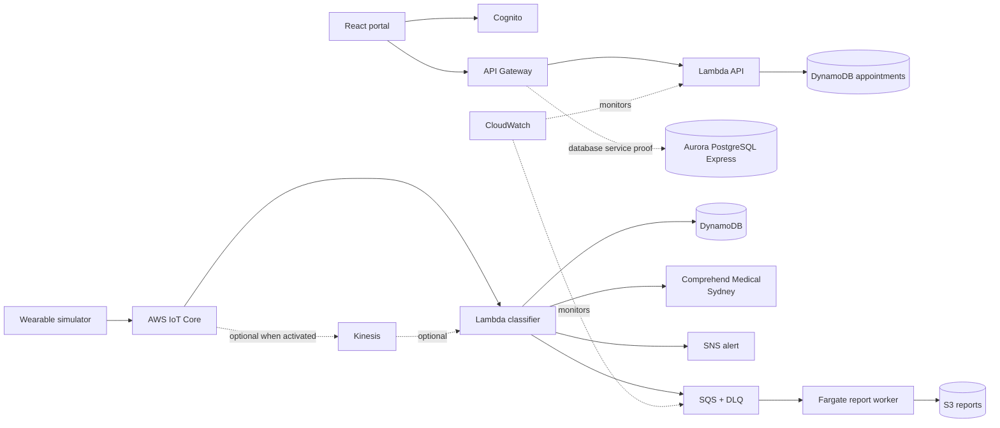

# MediConnect

**AI-powered remote patient monitoring and telemedicine on AWS.** MediConnect combines a responsive patient/doctor portal, synthetic wearable telemetry, real-time anomaly detection, alerting, and asynchronous incident reporting in a production-style event-driven architecture.

> Academic demonstration only. It is not a medical device, does not provide medical advice, and must use synthetic data unless a separately reviewed healthcare-compliance program is in place.

## What it demonstrates

- Patient and doctor authentication with Amazon Cognito
- Appointment APIs through API Gateway, Lambda, and Amazon Aurora PostgreSQL (RDS)
- Wearable MQTT ingestion with AWS IoT Core and Amazon Kinesis
- Threshold classification in Lambda and time-series storage in DynamoDB
- Clinical-note entity extraction with Amazon Comprehend Medical in Sydney (the service is unavailable in Mumbai)
- Immediate email alerts with SNS and durable incident jobs with SQS
- Containerized incident reports with Amazon ECR/ECS Fargate and encrypted S3 storage
- CloudWatch logs/alarms and a USD 15 AWS Budget notification

The primary stack is deployed in `ap-south-1` (Mumbai). Only Comprehend Medical is called in `ap-southeast-2` because AWS does not offer it in Mumbai.

## Live deployment

- Frontend: <http://mediconnect-dev-v4-frontendbucket-e7nhk2ftv3wi.s3-website.ap-south-1.amazonaws.com>
- API health: <https://9w5sd7nqil.execute-api.ap-south-1.amazonaws.com/prod/health>
- CloudFormation stack: `mediconnect-dev-v4` — `CREATE_COMPLETE`
- Aurora PostgreSQL Serverless v2: `mediconnect-express` — available, 0–4 ACUs, pauses after 5 minutes idle
- Cognito: user pool `ap-south-1_LThSWvZhi`, client `2dvf4phqo4l812q4b818f4rlql`
- Report bucket: `mediconnect-dev-v4-reportbucket-zt4ziguycljm`
- Worker image repository: `670099380958.dkr.ecr.ap-south-1.amazonaws.com/mediconnect-report-worker`

Deployment proof is stored locally in the handoff folder described in `AGENT.md`.

### Account-specific fallbacks

This AWS free-plan account rejected Kinesis until the service is activated, so the deployed IoT rule invokes the vitals Lambda directly. Kinesis remains available behind `EnableKinesis=true` in the template. Appointment runtime data uses the deployed DynamoDB fallback; the separately created Aurora Express cluster demonstrates the required RDS service while remaining scale-to-zero. The Cognito pool and JWT authorizer are deployed; the public frontend is a synthetic demonstration workspace and does not create real patient accounts.

## Architecture



## Repository layout

```text
src/                  React/TypeScript portal
backend/              API and vitals-processing Lambda handlers
backend/tests/        Classifier unit tests
worker/               Fargate incident-report container
infra/template.yaml   SAM/CloudFormation infrastructure
scripts/              Deployment and synthetic wearable utilities
```

## Local development

Requirements: Node.js 20+, pnpm/npm, and Python 3.12+.

```bash
pnpm install
pnpm dev
python -m unittest discover backend/tests -v
```

The UI runs in synthetic demo mode and does not need AWS credentials locally.

## AWS deployment

1. Authenticate the AWS CLI to account `670099380958`.
2. Confirm the region is `ap-south-1`.
3. Run:

```powershell
.\scripts\deploy.ps1 -AlertEmail eashwarashokvlsi@gmail.com
```

The script validates account/region, tests and builds the app, packages Lambda code, deploys CloudFormation, uploads the frontend, and saves stack outputs. Confirm the SNS subscription email after deployment.

The Fargate task definition is deployed with desired count zero to prevent an idle worker from exhausting the USD 15 budget. After the custom image is pushed to the generated ECR repository, run the task on demand for queued reports.

## Synthetic wearable demo

```bash
python scripts/wearable_simulator.py --count 20 --abnormal-every 5
```

To publish to IoT Core, provision a test device certificate and publish each JSON line to `mediconnect/<deviceId>/vitals`. Never commit device private keys.

## Security and cost controls

- Synthetic records only; no real patient data or phone numbers.
- Encryption at rest for RDS, DynamoDB, S3, SNS, and SQS.
- Least-privilege workload roles and Cognito JWT authorization.
- DynamoDB TTL (90 days), short log retention, S3 lifecycle, and Aurora auto-pause configuration.
- AWS Budget alerts at 80% actual and 100% forecast of USD 15. AWS Budgets alerts do **not** automatically stop resources.
- RDS snapshots, retained S3 buckets, and retained DynamoDB tables protect evidence during stack updates/deletion; remove them manually when the project is finished.

## Team

CloudPulse Innovators — S I Tharun Krishna (24BLC1270), Jegadiswar SM (24BVD1009), and Eashwar A (24BVD1051).

## License

MIT

